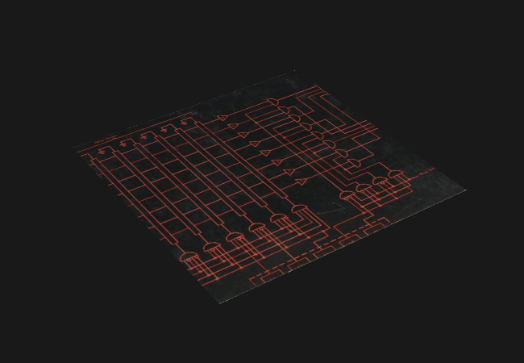

# cpp-vulkan-engine

<p align="center">
  
</p>

A Vulkan rendering engine in C++, built while learning from the official [Khronos Vulkan Documentation](https://docs.vulkan.org/spec/latest/index.html).

## Current state

Renders a rotating quad in perspective, textured with an image and transformed by model/view/projection matrices passed through uniform buffers.

<p align="center">
  
</p>

[Watch the demo on YouTube](https://www.youtube.com/watch?v=-XPyQug9jhY)

## Tech stack

- C++20, Vulkan (via Vulkan-Hpp RAII)
- GLFW, GLM
- CMake + vcpkg

## Building

```bash
cmake -B build -S src -DCMAKE_TOOLCHAIN_FILE=[path-to-vcpkg]/scripts/buildsystems/vcpkg.cmake
cmake --build build
```

## Structure

```
cpp-vulkan-engine/
├── CMake/        # Custom Find*.cmake modules
├── assets/       # Models and textures
├── screenshots/  # Images used in the README
└── src/          # Source code and shaders
```

## License

This project is licensed under the MIT License. See the bundled LICENSE file for details.