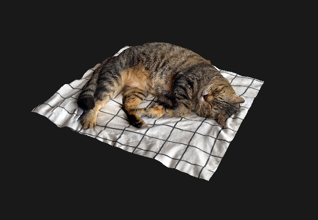

# cpp-vulkan-engine

<p align="center">
  
</p>

A Vulkan rendering engine in C++, built while learning from the official [Khronos Vulkan Documentation](https://docs.vulkan.org/spec/latest/index.html).

## Current state

Loads an OBJ model with its texture and renders it rotating in perspective, with depth testing.

<p align="center">
  
</p>

[Watch the demo on YouTube](https://www.youtube.com/watch?v=QXcEvJV5gbI)

## Tech stack

- C++20, Vulkan 1.4 (via Vulkan-Hpp RAII)
- GLFW, GLM
- stb_image, tinyobjloader
- Slang for shaders
- CMake + vcpkg

## Requirements

- A GPU and driver with Vulkan 1.4 support
- [Vulkan SDK](https://vulkan.lunarg.com/) (validation layers and the Slang compiler)
- [vcpkg](https://github.com/microsoft/vcpkg)
- CMake and a C++20 compiler

Developed and tested on Windows with Visual Studio.

## Building

```bash
cmake -B build -S src -DCMAKE_TOOLCHAIN_FILE=[path-to-vcpkg]/scripts/buildsystems/vcpkg.cmake
cmake --build build
```

CMake compiles the Slang shader into a `shaders` folder next to the executable.

## Structure

```
cpp-vulkan-engine/
├── CMake/        # Custom Find*.cmake modules
├── assets/       # Project assets
├── screenshots/  # Images used in the README
└── src/          # Source code and shaders
```

## License

This project is licensed under the MIT License. See the bundled LICENSE file for details.